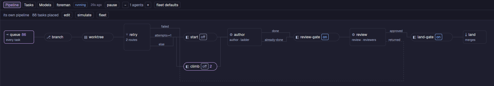
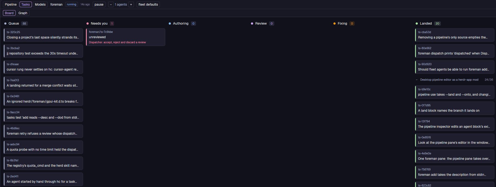
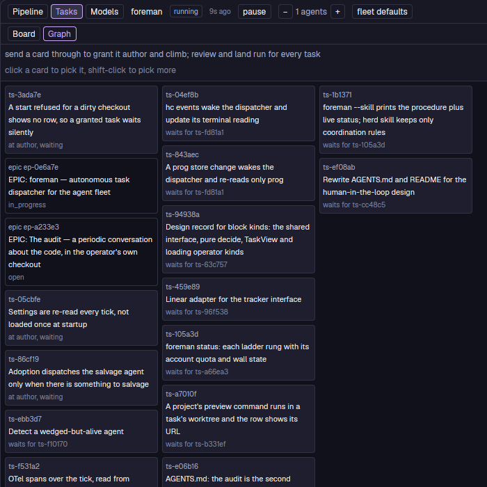
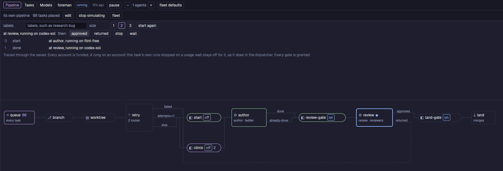
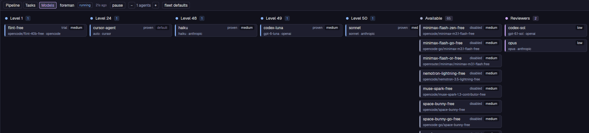

# foreman

foreman dispatches coding agents across a task backlog. You draw a pipeline of
blocks: where tasks come from, where an agent works, who writes the code, who
reviews it, and how it lands. foreman then moves each ready task through that
pipeline. When an agent stops, foreman reads the result, records it and starts
the next step.



Each block in the drawing is one step:

- **queue**: the ready tasks, which come from a tracker.
- **branch** and **worktree**: where the agent works.
- **retry**: a router. A task with an earlier attempt goes to the `climb`
  gate, and a new task goes to the `start` gate.
- **start**, **climb**, **review-gate** and **land-gate**: gates. Each gate is
  `on` (it runs by itself), `ask` (it waits for your approval) or `off`.
- **author** and **review**: agents. A model ladder picks the model for each
  run.
- **land**: merges the branch.

The labels on the wires are the exits that each agent can name when it ends
its run, for example `done`, `already-done`, `approved` and `returned`.

> **Status:** foreman runs its own development every day, on one machine.
> Expect sharp edges, and read `packages/foreman/AGENTS.md` before you run it
> unattended.

## The Foreman pane

foreman runs as a background service (`foreman serve`). The Foreman pane is a
[herdr-app](https://herdr.dev) mod that shows what it does, and it lets you
change it. The screenshots on this page are the pane on this repository's own
backlog.

### Tasks

The board puts each task in a column: Queue, Needs you, Authoring, Review,
Fixing and Landed. Click a card to see its runs and the commands it takes.
Drag a Queue card onto Authoring to let the fleet start it.



The graph puts each task after the tasks that block it. Pick cards and
**send them through** to let the fleet start them by itself.



### Simulate

**simulate** traces one task through the drawing. Choose an exit at each agent
to see the next block, the next model and the next gate, before a real agent
spends tokens.



### Models

The model ladder. Each level holds one or more rungs (a model in a harness),
cheapest level first. A task starts on the lowest level, and a failure sends it
up one level. Drag a rung to another level to move it, onto Available to turn
it off, or onto Reviewers to make it a reviewer.



## Workflows

One command draws a standard pipeline for a project:

```sh
foreman pipeline use checkout                         # your checkout, on the task's branch
foreman pipeline use worktree                         # a worktree for each task
foreman pipeline use direct                           # commits go directly onto your branch
foreman pipeline use worktree --onto develop          # land on develop
foreman pipeline use worktree --land fast-forward
foreman pipeline use worktree --land pull-request     # open a pull request, not a merge
```

Tasks come from a tracker that you choose for each project:

```sh
foreman policy tracker prog                                   # the local task store (the default)
foreman policy tracker github                                 # the issues of the project's GitHub repo
foreman policy tracker linear --team ENG --linear-project Web # a Linear project
```

## What is in this repository

| Folder | What it holds |
| --- | --- |
| [`packages/foreman`](packages/foreman) | The dispatcher, its command line, and the Foreman pane (`herdr/foreman`). |
| [`packages/tasks`](packages/tasks) | `tasks`, the command line of the local task store. |

## Running it

foreman needs [Bun](https://bun.sh), git, and herdr's `hc` (it runs each agent
in an `hc` terminal). It also needs `gh` for GitHub.

```sh
bun install
cd packages/foreman
bun src/main.ts status          # one reading of every project, printed
bun src/main.ts serve           # the dispatcher
```

To run the dispatcher at login, install its systemd user unit:

```sh
systemctl --user link ~/build/foreman/packages/foreman/systemd/foreman.service
systemctl --user enable --now foreman.service
```

To add the pane to herdr-app:

```sh
ln -s ~/build/foreman/packages/foreman/herdr/foreman ~/.config/herdr-app/mods/foreman
herdr-app do pane.split '{"direction":"right","mod":"foreman"}'
```

The fleet starts nothing by itself until a policy allows it: see
[What the fleet may do by itself](packages/foreman/README.md#what-the-fleet-may-do-by-itself).

## More

- [`packages/foreman/README.md`](packages/foreman/README.md): how the dispatcher
  works: ticks, the policy, workspaces, review, the ladder and the queue.
- [`packages/foreman/herdr/README.md`](packages/foreman/herdr/README.md): each
  view of the pane.
- [`packages/foreman/docs/`](packages/foreman/docs): design records for the
  pipeline engine, agent exits, workspace blocks and issue trackers.
