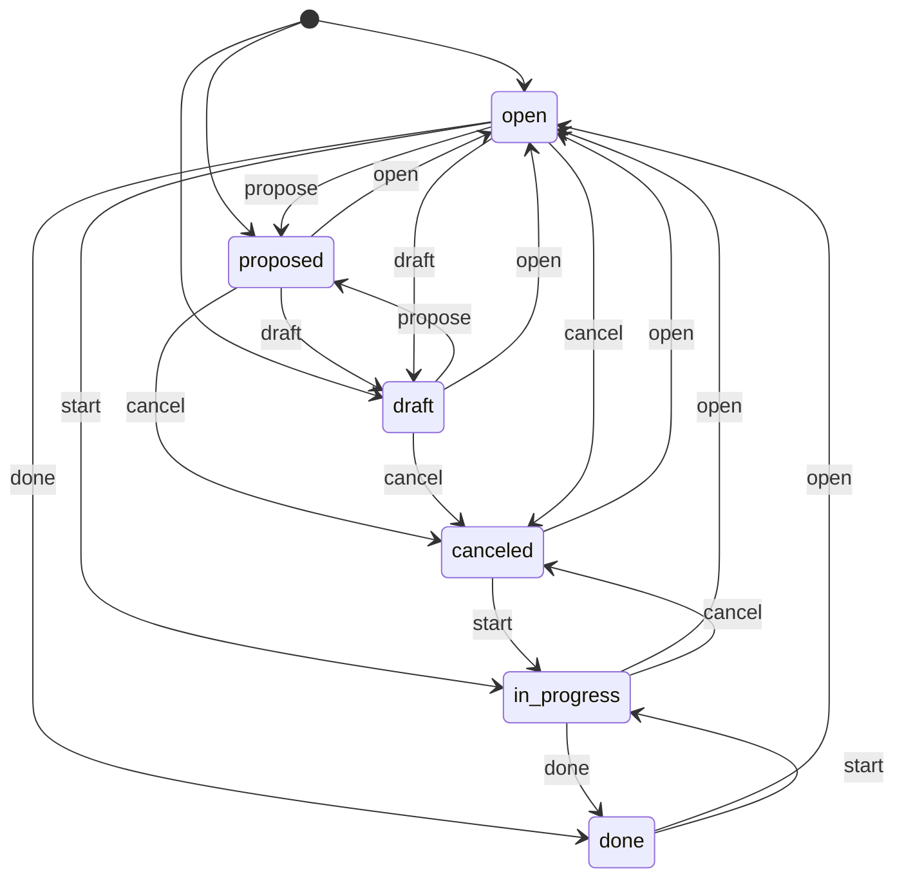
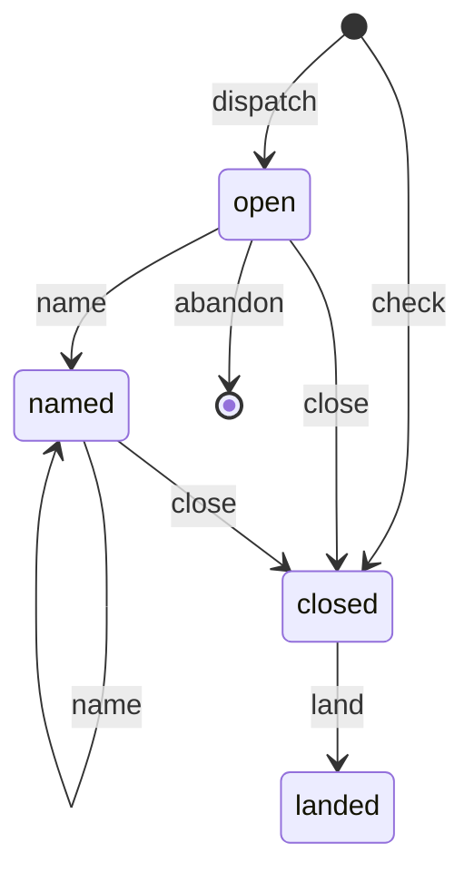

# Task and run machines

Status: deferred plan. Approved on 2026-11-02, then cut to what pays now: the
tracker seam, one-transaction `Records` functions for the paired writes listed
under Problem, and six statuses. The run machine, the joint table, the records
beside the runs and the in-memory test world wait until the hand-written rules
cause a failure.

## Problem

A task's status has a machine: `TASK_MACHINE` in `packages/tasks/src/item.ts`
lists every move, and the store refuses any other. A run has none. Its moves
are SQL spread over `packages/tasks/src/runs.ts` (`closeRun` keeps a named
exit, `landAuthorRun` sets the outcome, `deleteOpenRunOf` removes the row),
and its ending is a plain string.

Foreman pairs the two by hand. Each composite in `Records` (`release`,
`abandon`, `complete`, `nameExit`) holds one row of a transition table for
both machines. The dispatcher holds more rows as separate writes with
hand-written undo:

- `tracker.claim`, then `records.attribute`, with `release` in `tapError`
  (`dispatcher.ts`, dispatch). A crash between them leaves a claimed task with
  no author run.
- `endRuns(stopped)`, then `release`; `endReview(stopped)`, then `release`:
  two transactions each.
- `if (task.status !== "open") release` in five places, because
  `TASK_MACHINE` refuses `open` from `open`.
- The exit's status move, an inline conditional with a guard on the status.

The integration test's fake world copies all of this a second time, without
the guards, so a move the store refuses passes in the tests.

## Terms

- **Run machine**: the states a run row can be in, and the moves between
  them. Written as a `Machine` (`packages/tasks/src/machine.ts`), as the task
  machine is.
- **Joint table**: one row per foreman event, giving the tracker move and the
  run moves that go together. `Records` runs a row in one transaction.
- **Tracker move**: a `Tracker` method that changes a task's status (`claim`,
  `reopen`, `complete`).

## Six statuses

From ts-881e9e. `reviewing` goes; a task under review is `in_progress`, and
its step is the name of the block placement puts it at.

The `review` and `submit` events go. `start` also takes a done or canceled
task back to work, which is what foreman does with an unread branch on it.
A person can do the same with `tasks start`. The step shows only in foreman's
views (the dashboard and `foreman show`): the `tasks` package does not read
the drawing, and a task's runs already name the blocks it was at.

## Run machine

A run's state comes from its columns. There is no state column.

| State | Columns |
|---|---|
| open | `closed_at` empty, `ending` empty |
| named | `closed_at` empty, `ending` holds an exit |
| closed | `closed_at` set, outcome `handed-off` or `dropped` or empty |
| landed | `closed_at` set, outcome `committed` or `answered` |

- `stateOf(row)` reads the state, and each write in `runs.ts` checks its move
  with `transition(RUN_MACHINE, stateOf(row), event)`. That replaces the
  "not an open run" checks.
- `close` writes the process ending it is given (`stopped`, `vanished`,
  `walled`, `released`, `canceled`) only from `open`. From `named`, the exit
  stands, with the commit it was named on.
- `abandon` deletes the row: the agent never started. It is refused from
  `named`, because an agent that named an exit started.
- A check run is written `closed`; it has no agent.
- A correction round changes `rounds`, which is data, not state.
- A charge (from ts-4e763a) is a row in `charges`, not data on the run: an
  operator's floor charges rungs that never ran.

## Joint table

Written for six statuses. `Records` runs each row in one transaction, on the
connection the tracker writes on. `<ending>`, `<exit>` and `<rung>` are the
row's arguments.

| Event | Tracker move | Author run | Review run | Opens |
|---|---|---|---|---|
| dispatch author | claim | | | author |
| redispatch author | | close `vanished` | | author |
| dispatch review | | close `done` at the tip | close `released` | review |
| name exit, wire to `queue` | reopen | name `<exit>`, charge `<rung>` if `fails` | the same, on the open agent run | |
| name exit, wire to a block | | name `<exit>`, charge `<rung>` if `fails` | the same, on the open agent run | |
| stop | reopen | close `stopped`, charge `<rung>` if spent | close `stopped` | |
| end review | | | close `<ending>` | |
| release | reopen | close `<ending>` | close `released` | |
| abandon author | reopen | abandon | | |
| abandon review | | | abandon | |
| complete | complete | close `released`, then land | close `released` | |
| resume branch | claim | | | |
| check | | | | check, written closed |

- **Skip rule.** `Records` skips a tracker move to the status the task already
  has. This replaces the five `task.status !== "open"` checks.
- **Exit moves come from the drawing.** The exit's wire decides between the
  two "name exit" rows. The dispatcher's conditional on role and status goes.
- **Legal by test.** A pure test checks each row: its tracker move against
  `TASK_MACHINE`, and its run moves against `RUN_MACHINE`.

## Records beside the runs

From the State section of `docs/agent-exits.md` (ts-4e763a). Labels stop
carrying foreman's state:

Built on ts-4e763a; `docs/agent-exits.md`, State, has the table. `Records`
writes `charges` (`markFailure`, `clearFailure`) and `parks` (`park`,
`unpark`); attempts and walls are read from the runs. The tracker carries only
task state, the operator's own labels (`size:N`, `research`) and
`diagnosing:<intent>`.

## Tests

The integration tests run the real `Records` and `TasksTracker` over an
in-memory SQLite store, so no fake copies either machine. The fake world keeps
only the fleet, the repository and the clock.

## Build order

One branch, in this order. Each step passes the gate (tests, typecheck, lint,
`ripwire --quality-delta`, place-diff identical) before the next one starts.

1. Tracker seam: `Tracker` and `Records` (done, not committed).
2. Six statuses in the tasks package: the machine, a migration from
   `reviewing` to `in_progress`, and `tasks review` removed.
3. Run machine in the tasks package: `RUN_MACHINE`, `stateOf`, checked
   writes, and the `charged` column.
4. Joint table in `Records`; the dispatcher's paired writes become rows.
5. `parks` and `forgiven` tables, and the label migration.
6. Integration tests on the in-memory store; the fake records go.

## Rules this replaces

- `docs/agent-exits.md`, "What is built", Status bullet: "an author's exit puts
  it in `reviewing`". Replaced by the six statuses.
- `docs/agent-exits.md`, Changes, "The store": "`tasks verdict` and `tasks
  review` stay for people who use `tasks` without foreman". Conflicts with
  ts-881e9e, which removes `tasks review`. ts-881e9e wins (operator decision
  2026-11-02).
- `docs/agent-exits.md`, open question 2: answered by the six statuses.
- `packages/foreman/AGENTS.md`, "The review gate": "`reviewing` is a status
  anything can set", and "The task stays in `reviewing`". Replaced by the six
  statuses.
- `docs/runs-replace-labels.md` and `docs/pipeline-engine.md`: rules on what
  `Prog.release` clears. Replaced by the joint table's `release` row.
