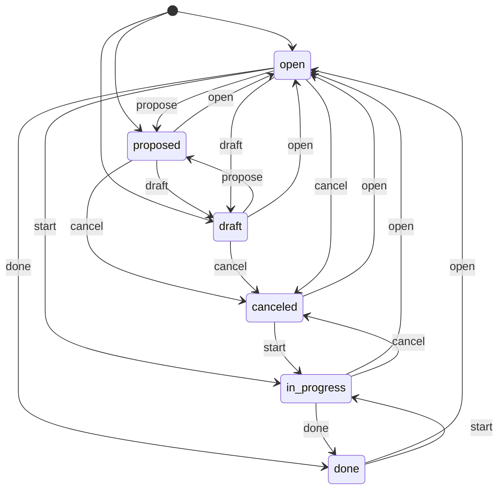

# Task and run machines

A task has two kinds of state. Its status is a machine in the tracker. Its runs
are foreman's records. This page says what each one is, and how one dispatcher
event changes both.

## Why one row per event

A task's status has a machine: `TASK_MACHINE` in `packages/tasks/src/item.ts`
lists every move, and the store refuses any other. The runs have no machine.
Their moves are SQL in `packages/tasks/src/runs.ts` (`closeRun` keeps a named
exit, `landAuthorRun` sets the outcome, `deleteOpenRunOf` removes the row), and
a run's ending is a plain string.

A dispatcher event changes both kinds of state. Foreman writes the effect of
each event as one **joint row**: the tracker move and the run writes that go
together. `Records` runs a row in one transaction. So the two kinds of state
change together, or not at all.

## Terms

- **Tracker move**: a `Tracker` method that changes a task's status (`claim`,
  `reopen`, `complete`).
- **Joint row**: the tracker move and the run writes that one event makes.
  `stepOf` decides it.
- **Joint table**: the rows for every event, in `src/run-step.ts`.

## Six statuses

`reviewing` is not a status. A task under review is `in_progress`, and its step
is the name of the block that placement puts it at.

`start` also takes a done or canceled task back to work. Foreman does this with
an unread branch on it. A person does the same with `tasks start`. The step
shows only in foreman's views (the dashboard and `foreman show`). The `tasks`
package does not read the drawing. A task's runs already name the blocks it was
at.

## Runs

A run's state comes from its columns. There is no state column.

| State | Columns |
|---|---|
| open | `closed_at` empty, `ending` empty |
| named | `closed_at` empty, `ending` holds an exit |
| closed | `closed_at` set, outcome `handed-off`, `dropped` or empty |
| landed | `closed_at` set, outcome `committed` or `answered` |

- A close writes a process ending (`stopped`, `vanished`, `walled`, `released`,
  `canceled`). An exit that the run already named stands. The close does not
  replace it.
- An abandoned run is deleted. An agent that named an exit started, so the
  delete never removes a named run.
- A check run is written closed. It has no agent.
- A correction round changes `rounds`. That is data, not state.
- A charge is a row in `charges`, not data on the run. An operator's floor
  charges rungs that never ran.

## Joint table

`stepOf` in `src/run-step.ts` takes an event, the task, and the rules: the
ladder, `attemptsPerLevel`, and the task's drawing. It returns one row.
`Records.write` writes the row in one transaction, on the connection the tracker
writes on. Then the dispatcher does its own I/O: logs, notices, git and stopping
panes.

A row writes in this order: complete, close, name the exit, record the check,
charge, park, open, land, then claim or reopen. A charge records the task's
newest run. So a charge follows the check run it is about, and comes before the
run the row opens.

| Event | Tracker move | Author run | Review run | Charges, park | Opens |
|---|---|---|---|---|---|
| `AuthorStarted` | claim | | | | author |
| `AuthorReplaced` | claim | close `vanished` | | | author |
| `ReviewStarted` | | close `done` at the run's commit | close `released` | | review |
| `ExitNamed` | reopen if the exit's wire goes to `queue` | name the exit on the open agent run | the same | | |
| `HandedOff` | | close `done` at the tip | close `stopped` | the exit's `fails` | |
| `ReviewReturned` | | | close `released` | the exit's `fails` (a review block names only `author`) | |
| `Requeued` | | close `released` | close `released` | | |
| `Stalled`, block says `park` | reopen | close `stopped` | close `stopped` | park | |
| `Stalled` reviewer, a reviewer is left | | | close `stopped` | | |
| `Stalled` reviewer, none left | reopen | close `released` | close `stopped` | park | |
| `Stopped`, block says `retry` | reopen | close `stopped` or `vanished` | close `released` | climb if the stop spends the rung | |
| `Walled` author | reopen | close `walled` | close `released` | | |
| `Walled` reviewer | | | close `walled` | | |
| `Checked`, passed | | | | | check, written closed |
| `Checked`, failed | reopen if `failed` goes to `queue` | close `released` if it reopens | close `released` if it reopens | the `failed` exit's `fails` | check, written closed |
| `Landed` | complete | close `released`, then land (`answered` for a `research` task) | close `released` | | |
| `Conflicted` | reopen | close `released` | close `released` | | |
| `Withdrawn` | reopen | close `released` | close `released` | | |
| `Broke` | reopen | close `released` | close `released` | climb | |
| `Climbed` | | | | climb | |

- **An exit stands.** A close writes its ending only on a run with no exit. An
  author run that named an exit keeps the commit it named.
- **Charges.** `fails: author` is a climb. It charges the rung of the task's last
  author run. `fails: self` charges the rung of the author block that named the
  exit. A check and a reviewer have no rung, so the drawing check refuses
  `fails: self` there.
- **Skip rule.** `Records` skips a tracker move to the status the task already
  has.
- **Exit moves come from the drawing.** The exit's wire decides whether naming
  it reopens the task.

**Not in the table.** These paths make one write, or a move the tracer does not
make. They call `Records` methods directly: the operator's own moves (release,
kill, unassign, descend, the floor, adopt, diagnose), the tidy passes, a park
block, a block with no rung left, settle's close of a task completed or canceled
by hand, abandoning a run that never started, and correction rounds.

## Tracing

`foreman pipeline trace` folds `stepOf` and `applyRow` over a pretend task. It
prints the placement after each event. `applyRow` in `src/run-step.ts` applies a
row to a task held in memory. The integration tests check that the trace places
the task where the dispatcher does after each event.

## Tests

The fake world in `src/dispatcher.integration.test.ts` applies each row with
`records.write` and `applyRow`. So it holds no copy of the joint table.

## Records beside the runs

Foreman's records are in the same SQLite store as the runs, keyed by task id:

- `charges`: one row each time a rung is charged with failing a task. `run` is
  the newest run on the task at that time. `forgiven_at` is set when the
  operator takes the charge back.
- `parks`: one row per task parked for the operator. The row goes when the
  operator acts.

Labels carry no foreman state. The tracker holds task state, the operator's own
labels (`size:N`, `research`) and `diagnosing:<intent>`.
